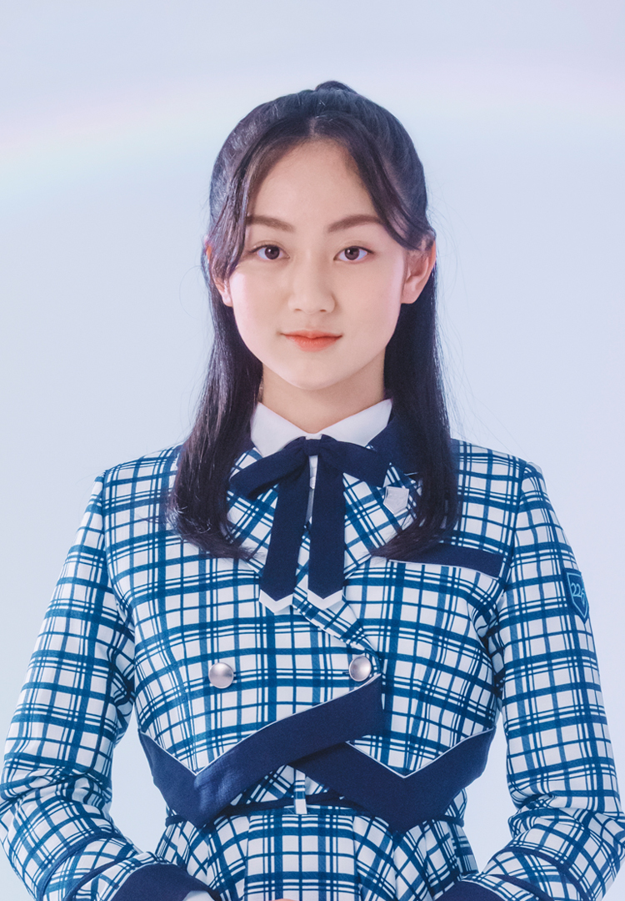
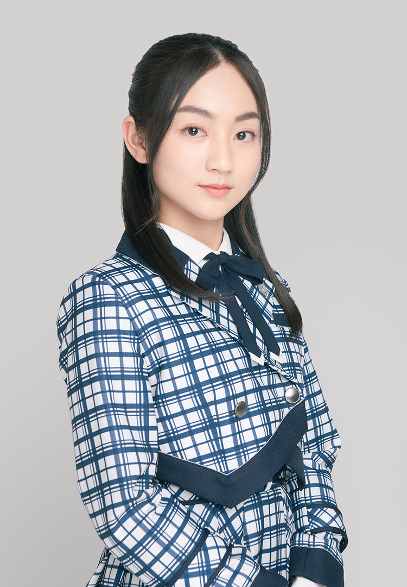

???+ quote "ひとこと"
    電撃担当月城咲舞です！必殺ナナニジクラッシュ！
    
!!! general inline end "月城咲舞"
    === "十六单"

        { loading=lazy }

    === "三专"

        { loading=lazy }

    === "十五单"

        { loading=lazy }

    === "十四单"

        { loading=lazy }

    === "十三单"

        { loading=lazy }
    
    === "十二单"

        { loading=lazy }
    
    === "二专"

        { loading=lazy }

    === "十一单"

        { loading=lazy }

    === "十单"

        { loading=lazy }

    === "九单(v2)"

        { loading=lazy }

    === "九单(v1)"

        { loading=lazy }
        
    --------

    <b>姓名</b>   月城咲舞

    --------

    <b>生日</b>    5月22日

    --------

    <b>血型</b>    O

    --------

    <b>身高</b>  156cm

    --------

    <b>出生</b> 福岡県
    
    --------

    <b>角色</b> 氷室みず姫

  

    [:fontawesome-brands-twitter:](https://twitter.com/emma_tsukishiro) [:fontawesome-brands-tiktok:](https://www.tiktok.com/@emma_tsukishiro)

    [Blog](https://blog.nanabunnonijyuuni.com/s/n227/diary/blog/list?ima=5436&ct=19){ .md-button}

## 时间线
### 2021 

- 报名参加22/7二期生甄选并合格

### 2022

- 2月27日在ナナニジ House中初次亮相
- 4月20日在“14”东京追加公演上宣布为氷室みず姫配音

### 2023

- 12月12日，宣布因专注学业，从12月23日起暂停22/7及相关活动

### 2024

- 3月3日，恢复22/7活动

## 相关

- 有一个弟弟
- 从小就喜欢跳舞，也一直觉得如果能把喜欢的事情作为工作会很开心
- 被认为是22/7中舞蹈能力较强的成员之一，经常在组合TikTok上投稿翻跳视频
- 兴趣是翻跳、原创舞蹈和听音乐
- 特技是绕口令和忍者跳
- 喜欢年糕
- 似乎喜欢ONE OK ROCK
- 因为长长的八字刘海和比较有棱角的眉毛，外形特征比较容易辨认
- MBTI是ENFP
- 自称不是容易感到寂寞的类型
- 被其他成员称作王子
- 曾和一期生武田爱奈一起吃饭，虽然两人没有在22/7同一时期活动过，但爱奈提到两人的思考方式相似，所以很合得来

=== "加法中"
    <iframe src="https://player.bilibili.com/player.html?aid=682109969&bvid=BV1EU4y1o7dh&cid=543256786&page=1&autoplay=0" autoplay="0" scrolling="no" border="0" frameborder="no" framespacing="0" allowfullscreen="true" width="100%" height="720"> </iframe>
    [:pack-bili-tv: 前往bilibili观看](https://www.bilibili.com/video/BV1EU4y1o7dh){ .md-button .md-button--primary }
    [:fontawesome-brands-youtube: 前往YouTube观看](https://www.youtube.com/watch?v=awlFsjOXTDs){ .md-button .md-button--primary }

## FREE TALK

