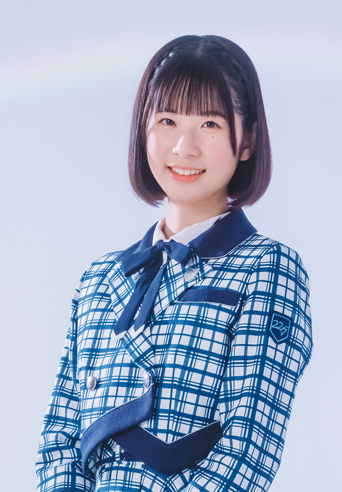
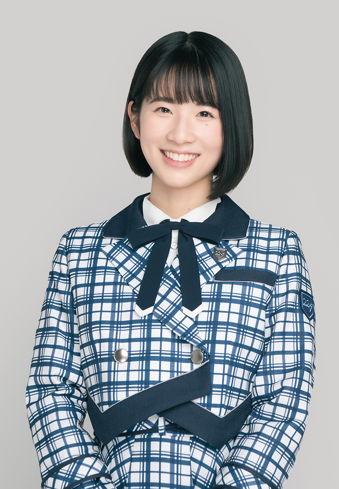

???+ quote "ひとこと"
    夢は皆さんを笑顔にすること、あざとく愛嬌を振りまきます♡ 応援よろしくお願いします！
!!! general inline end "相川奈央"
    === "十六单"

        { loading=lazy }

    === "三专"

        { loading=lazy }

    === "十五单"

        { loading=lazy }

    === "十四单"

        { loading=lazy }    
        
    === "十三单"

        { loading=lazy }

    === "十二单"

        { loading=lazy }

    === "二专"

        { loading=lazy }

    === "十一单"

        { loading=lazy }

    === "十单"

        { loading=lazy }

    === "九单(v2)"

        { loading=lazy }
        
    === "九单(v1)"

        { loading=lazy }

    --------

    <b>姓名</b>   相川奈央

    --------

    <b>生日</b>    7月6日

    --------

    <b>血型</b>    O

    --------

    <b>身高</b>  158cm

    --------

    <b>出生</b> 東京都

    --------

    <b>角色</b> 西浦そら
  

    [:fontawesome-brands-twitter:](https://twitter.com/nao_aikawa227)
    
    [Blog](https://blog.nanabunnonijyuuni.com/s/n227/diary/blog/list?ima=3909&ct=13){ .md-button }

## 时间线
### 2021 

- 报名参加22/7二期生甄选并合格

### 2022

- 2月27日在ナナニジ House中初次亮相
- 4月20日在“14”东京追加公演上宣布为西浦そら配音

## 相关

- 小学五年级时曾在美国生活一年，并在美国完成小学毕业，因此会说简单的英语
- 从小学一年级开始就喜欢舞台表演，曾参加学校的戏剧演出，也有担任主角的经历
- 小时候也常在家模仿舞蹈和演奏乐器
- 在六单时期成为了22/7的粉丝，后来在同样喜欢22/7的朋友鼓励下报名参加二期生甄选。在参加甄选前纠结了很久，最后是在报名截止日当天早上提交了申请
- 喜欢编舞，自称是队形宅，也曾参与22/7部分Live舞蹈段落的编排
- 担任过虚拟YouTuber Pepechi的编舞老师
- 会弹钢琴，曾在学校合唱比赛中担任钢琴伴奏
- 特技是镜像书写和做一百种表情
- 喜欢烘焙、乌冬和水果
- 爱吃乌冬，如果生日餐不是乌冬会感到失落
- 喜欢漫画，尤其喜欢少女漫画《主人恋日記》
- 不擅长和初次见面的人说话，也不太擅长机械类操作
- 怕冷所以不喜欢冬天，不过喜欢看女孩子的冬季穿搭
- 喜欢的季节似乎是秋天
- 喜欢的22/7歌曲是[最后的钢琴](/songs/unit/#白组)
- 认为自己和西条和是完全相反的类型

=== "加法中"
    <iframe src="https://player.bilibili.com/player.html?aid=936901696&bvid=BV1yT4y1Q7PT&cid=540685732&page=1&autoplay=0" autoplay="0" scrolling="no" border="0" frameborder="no" framespacing="0" allowfullscreen="true" width="100%" height="720"> </iframe>
    [:pack-bili-tv: 前往bilibili观看](https://www.bilibili.com/video/BV1yT4y1Q7PT){ .md-button .md-button--primary }
    [:fontawesome-brands-youtube: 前往YouTube观看](https://www.youtube.com/watch?v=Ytcjw7_YP1w){ .md-button .md-button--primary }

## FREE TALK

