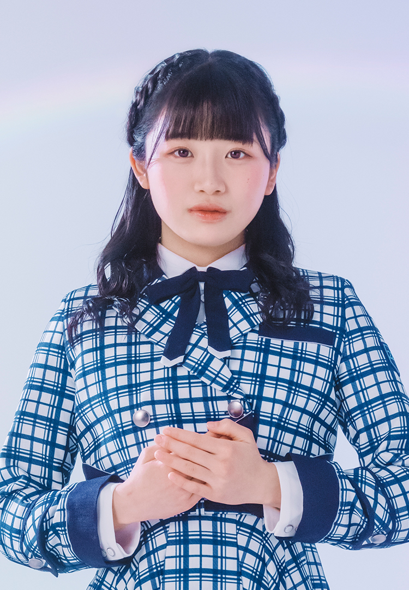
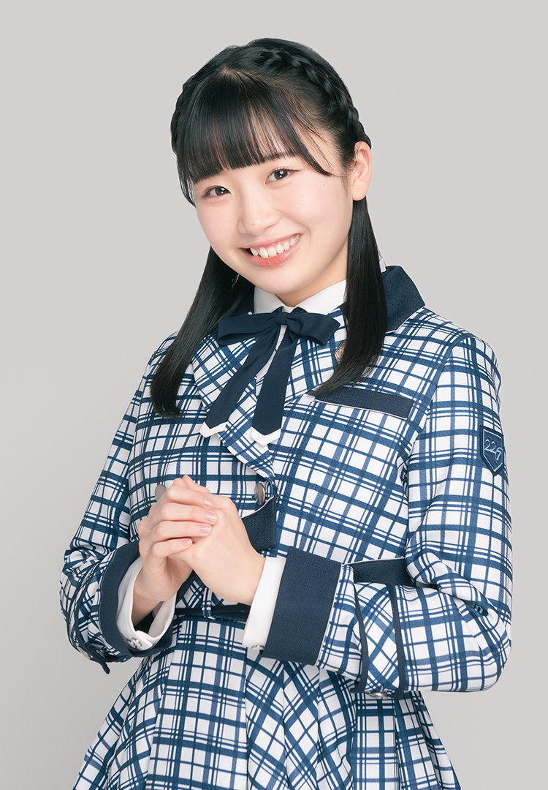

???+ quote "ひとこと"
    チアスマイル全開で皆様の心に猛突進！不器用だけど全力で頑張ります。
!!! general inline end "望月りの"
    === "十六单"

        { loading=lazy }

    === "三专"

        { loading=lazy }

    === "十五单"

        { loading=lazy }

    === "十四单"

        { loading=lazy }

    === "十三单"

        { loading=lazy }

    === "十二单"

        { loading=lazy }

    === "二专"

        { loading=lazy }

    === "十一单"

        { loading=lazy }

    === "十单"

        { loading=lazy }

    === "九单(v2)"

        { loading=lazy }
        
    === "九单(v1)"

        { loading=lazy }

    --------

    <b>姓名</b>   望月りの

    --------

    <b>生日</b>    3月29日

    --------

    <b>血型</b>    O

    --------

    <b>身高</b>  157cm

    --------

    <b>出生</b> 神奈川県

    --------

    <b>角色</b> 濑良穂乃花
  
    <figure markdown>
        { width="100" loading=lazy }
        <figcaption>签名</figcaption>
    </figure>
    [:fontawesome-brands-twitter:](https://twitter.com/rino_mochizuki) [:fontawesome-brands-instagram:](https://twitter.com/cure_rinochi) [:fontawesome-brands-tiktok:](https://www.tiktok.com/@cure_rinochi)
       
    [Blog](https://blog.nanabunnonijyuuni.com/s/n227/diary/blog/list?ima=3919&ct=20){ .md-button}

## 时间线
### 2021 

- 报名参加22/7二期生甄选并合格

### 2022

- 2月27日在ナナニジ House中初次亮相
- 4月20日在“14”东京追加公演上宣布为濑良穂乃花配音

### 2023

- 3月7日，因为身体问题，暂停活动
- 5月25日，在宫濑玲奈毕业演唱会上恢复活动

## 相关

- 有一个弟弟，小时候也经常待在祖母家
- 从小梦想成为偶像
- 学生时代不太擅长学习，尤其不擅长数学和物理，不过英语还算可以
- 体育课也不太擅长，甚至一度被同学认为“和りの同队就会输”
- 因为这些经历，曾经逐渐对自己失去自信
- 甄选期间看到很多可爱的候选者时，曾觉得自己是不是不该参加甄选
- 对自己的唱歌和啦啦队能力很有信心，称其为自己的“最终兵器”
- 目标是成为国民级偶像，也想站上东京巨蛋和武道馆
- 梦想是有一天能够solo唱歌，把自己的歌声传递给更多人
- 也想尝试和光之美少女相关的工作
- 以前是重度游戏玩家，经常一起床、吃饭、坐车时都在玩游戏
- 喜欢《动物森友会》《Girls Mode》《朋友聚会》《任天堂明星大乱斗》《任天狗狗+猫猫》等游戏
- 是光之美少女的粉丝
- 也喜欢高岭抚子成员松本ももな
- 经常在YouTube上看灵异、阴谋论、恐怖故事和有趣新闻类内容
- 左撇子
- 自称大概是大家口中的“笨蛋角色”
- MBTI是ENFP
- 和阿和关系很好
- 是二期生中第一位主动和西条和说话的成员，也曾在活动结束后和阿和一起走到车站
- 觉得加入22/7后最开心的是，找到了一个能够接纳自己缺点、并把缺点也当作个性的地方
- 被三期生橘まな认为是完美的偶像
- 曾经参加过其他偶像的甄选  因为这一点被日网黑粉狂喷
- 在表演二期生加入之前的歌曲时，经常唱千春的part
- 喜欢的22/7歌曲是[僕らの環境](/songs/single/4th/song-2/)

=== "加法中"
    <iframe src="https://player.bilibili.com/player.html?aid=683395132&bvid=BV1yS4y1A7Si&cid=583609412&page=1&autoplay=0" autoplay="0" scrolling="no" border="0" frameborder="no" framespacing="0" allowfullscreen="true" width="100%" height="720"> </iframe>
    [:pack-bili-tv: 前往bilibili观看](https://www.bilibili.com/video/BV1yS4y1A7Si){ .md-button .md-button--primary }
    [:fontawesome-brands-youtube: 前往YouTube观看](https://www.youtube.com/watch?v=vAjmK7rnQeY){ .md-button .md-button--primary }

## FREE TALK

