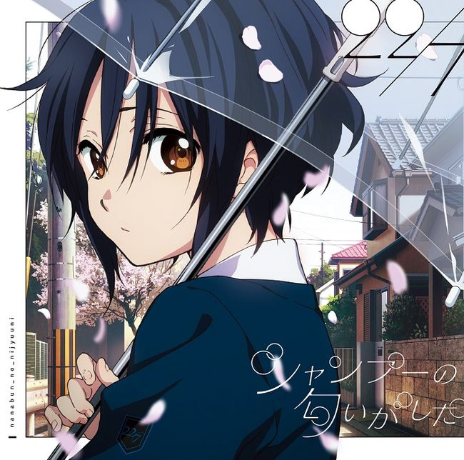
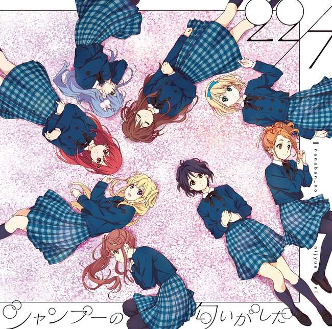

# :pack-hires: 散发出了香波的气息

!!! general inline end "歌曲信息"

    === "完全生产限定版Type-A"
        
    === "完全生产限定版Type-B"
        
    
    
:pack-hires: Hi-Res Lossless

    
    --------

    <b>专辑名称:</b> 散发出了香波的气息

    --------
    
    <b>日文名称:</b> シャンプーの匂いがした

    --------
    
    <b>类型:</b> 单曲

    --------
    
    <b>发行日期:</b> 2018年4月11日

    --------

    <b>制作人:</b> 秋元康

    --------

    <b>作词:</b> 秋元康

    --------

    <b>发行公司:</b> Sony Music Records

散发出了香波的气息(シャンプーの匂いがした)是22/7的第2张单曲，也是单曲中主打歌的歌名，在2018年4月11日发布。

## 歌曲列表

### 完全生产限定盘 Type-A

#### CD

| No.     | 标题                          | 时长 |
| --------| ------------------------------------ | -------- |
| 1.      | [:pack-hires: 散发出了香波的气息(シャンプーの匂いがした)](/songs/single/2nd/song-1/) | 4:28 |
| 2.      | [:pack-hires: 人格崩坏(人格崩壊)](/songs/single/2nd/song-2/) | 4:17 |
| 3.      | [:pack-hires: 温柔的记忆(やさしい記憶)](/songs/single/2nd/song-3/) | 4:23 |
| 4.      | 散发出了香波的气息(シャンプーの匂いがした)-off vocal ver.- | 4:28 |
| 5.      | 人格崩坏(人格崩壊)-off vocal ver.- | 4:17 |
| 6.      | 温柔的记忆(やさしい記憶)-off vocal ver.- | 4:22 |

总时长：26:15

#### DVD

| No.     | 标题                          | 时长 |
| --------| ------------------------------------ | ------- |
| 1.      | 散发出了香波的气息(シャンプーの匂いがした)(music video) |   |

### 完全生产限定盘 Type-B

#### CD

| No.     | 标题                          | 时长 |
| --------| ------------------------------------ | -------- |
| 1.      | [:pack-hires: 散发出了香波的气息(シャンプーの匂いがした)](/songs/single/2nd/song-1/) | 4:28 |
| 2.      | [:pack-hires: 人格崩坏(人格崩壊)](/songs/single/2nd/song-2/) | 4:17 |
| 3.      | [:pack-hires: 只能呐喊的青春(叫ぶしかない青春)](/songs/single/2nd/song-4/) | 5:05 |
| 4.      | 散发出了香波的气息(シャンプーの匂いがした)-off vocal ver.- | 4:28 |
| 5.      | 人格崩坏(人格崩壊)-off vocal ver.- | 4:17 |
| 6.      | 只能呐喊的青春(叫ぶしかない青春)-off vocal ver.- | 5:04 |

总时长：27:39

#### DVD

| No.     | 标题                          | 时长 |
| --------| ------------------------------------ | ------- |
| 1.      | Documentary of 22/7 |  |

### 通常盘

#### CD

| No.     | 标题                          | 时长 |
| --------| ------------------------------------ | -------- |
| 1.      | [:pack-hires: 散发出了香波的气息(シャンプーの匂いがした)](/songs/single/2nd/song-1/) | 4:28 |
| 2.      | [:pack-hires: 人格崩坏(人格崩壊)](/songs/single/2nd/song-2/) | 4:17 |
| 3.      | [:pack-hires: 循环巴士(循環バス)](/songs/single/2nd/song-5/) | 4:27 |
| 4.      | 散发出了香波的气息(シャンプーの匂いがした)-off vocal ver.- | 4:28 |
| 5.      | 人格崩坏(人格崩壊)-off vocal ver.- | 4:17 |
| 6.      | 循环巴士(循環バス)-off vocal ver.- | 4:25 |

总时长：26:22

## 试听

### 网易云音乐

<meting-js
        id="38273111"
        server="netease"
        order="list"
        type="album"
        list-olded="true"
        autoplay="false"
        mutex="true"
        volume=0.5
        theme="#0091eb"
        >
</meting-js>

## 视频

=== "Music Video"
    <iframe src="https://player.bilibili.com/player.html?aid=543026844&bvid=BV1Ti4y157Qo&cid=265042201&p=1&autoplay=0" autoplay="0" scrolling="no" border="0" frameborder="no" framespacing="0" allowfullscreen="true" width="100%" height="720"> </iframe>
    [:pack-bili-tv: 前往bilibili观看](https://www.bilibili.com/video/BV1Ti4y157Qo){ .md-button .md-button--primary }
    [:fontawesome-brands-youtube: 前往YouTube观看](https://www.youtube.com/watch?v=79qPHlqistg){ .md-button .md-button--primary }

