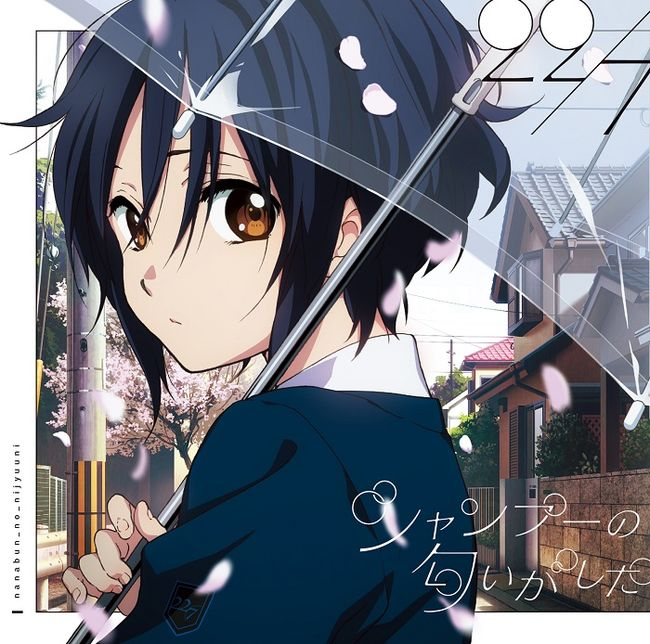
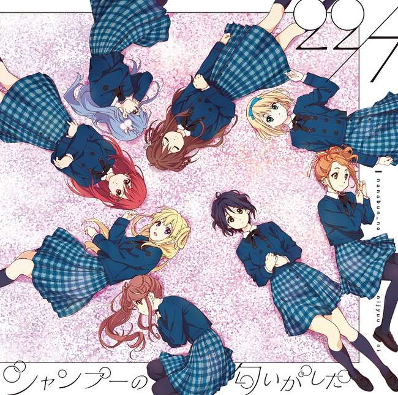

# :pack-hires: 温柔的记忆

!!! general inline end "歌曲信息"

    === "完全生产限定版Type-A"
        
    === "完全生产限定版Type-B"
        
    --------
    
    <b>歌曲名称:</b> 温柔的记忆

    --------

    <b>日文名称:</b> やさしい記憶

    ---------
    
    <b>类型:</b> 歌曲

    --------
    
    <b>发行日期:</b> 2018年4月11日

    --------

    <b>收录专辑:</b> 《シャンプーの匂いがした》

    --------

    <b>制作人:</b> 秋元康

    --------

    <b>作词:</b> 秋元康

    --------

    <b>作曲:</b> 大冢刚毅

    --------

    <b>编曲:</b> 大冢刚毅

    --------

    <b>时长:</b> 4:23
 
    --------

    <b>排行榜:</b> Oricon周榜第八名
    
    --------

    <b>发行公司:</b> Sony Music Records

## 简介

《温柔的记忆》是收录在22/7第2张单曲《散发出了香波的气息》完全生产限定盘Type-A中的曲目，作词由秋元康负责，作曲和编曲由大冢刚毅负责，单曲于2018年4月11日正式发售，总时长4分23秒，首周取得了Oricon周榜第八名的位置。

=== "振付映像"
    <iframe src="https://player.bilibili.com/player.html?aid=748620175&bvid=BV1TC4y177nr&cid=1336726027&p=1&autoplay=0" autoplay="0" scrolling="no" border="0" frameborder="no" framespacing="0" allowfullscreen="true" width="100%" height="720"> </iframe>
    [:pack-bili-tv: 前往bilibili观看](https://www.bilibili.com/video/BV1TC4y177nr){ .md-button .md-button--primary }
    [:fontawesome-brands-youtube: 前往YouTube观看](https://www.youtube.com/watch?v=jXiUG1QX_SY){ .md-button .md-button--primary }

## 歌词

=== "日语"
    

    狭い校庭のフェンスの脇

    咲いてた花の名前　なんて言ったっけ？

    みんな知らなくて調べたんだ

    僕の植物図鑑　片隅に載ってた

    忘れることって便利だと思う

    クラスメイトの誰かまで

    どこかに消えてしまったよ

    やさしい記憶なんて　あやふやで

    これ以上　僕のこと傷つけはしない

    悲しいことは　きっと勘違い

    人に聞いたのを信じ込んだだけ

    終わったことなんか終わったままでいいよ

    夏の教室の日差しの中

    窓際の君のこと　いつも盗み見た

    何も言い出せず　秋になって

    やがて心の花も枯れてしまったよ

    覚えてないのは悲しいからだろう

    過ぎた月日の思いやり

    あの日の自分は嫌いだ

    ホントの記憶　どこかぼんやりと

    切ないベールで守ってくれてる

    真実なんてどうだっていいことなのか？

    人はそう過去を美化してしまうよ

    未来はいつだって上書きのためにある

    やさしい記憶なんて　あやふやで

    これ以上　僕のこと傷つけはしない

    大事なことは　ある日　振り向けば

    ほんの一瞬だけ　思い出すものさ
    
    どうでもいいことなんかどこにもないと知った

=== "翻译"
    

    翻译来源：227中文应援会

    [offset:0]

    狭小校园的栅栏边

    绽放了的花 名字叫什么来着

    大家都不知道 纷纷开始查询

    记录在了我的植物图鉴的角落里

    就连觉得遗忘很便利的同班同学的谁

    也消失到了哪里去了呢

    暧昧着的温柔记忆

    已经不会再伤害到我了

    悲伤的事肯定是弄错了

    只不过是对别人的话深信不疑

    结束了的事情就让它结束吧

    盛夏的教室里的阳光中

    总是在窥视着窗边的你

    一言未发便转眼到了秋天

    心中的花也随之逐渐枯萎了

    没有记住的大概都是悲伤的记忆吧

    逝去的岁月的关怀

    讨厌在那一天的自己

    真正的记忆正在哪里一边发着呆

    一边被悲伤的面纱守护着呢

    真相真的是怎样都无所谓的事吗

    人们总是像那样美化着过去

    只有未来是为了随时都能够被改写而存在

    暧昧着的温柔记忆

    已经不会再伤害到我了

    在某一天回首展望重要的事情的话

    有那么一瞬会回忆起来

    那天意识到了 世上没有什么事是无所谓的
    

