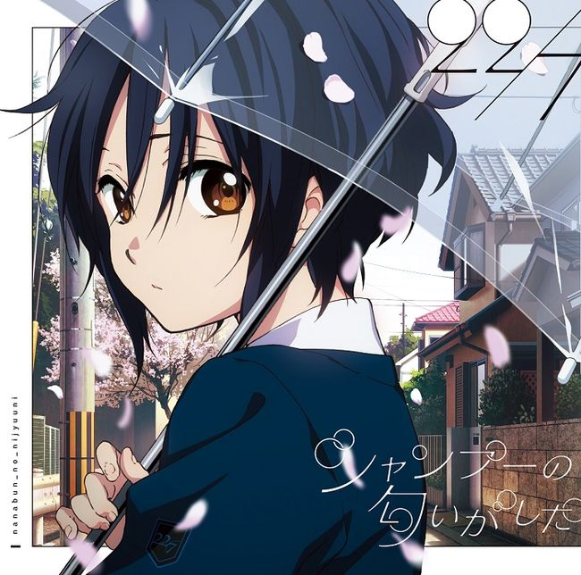
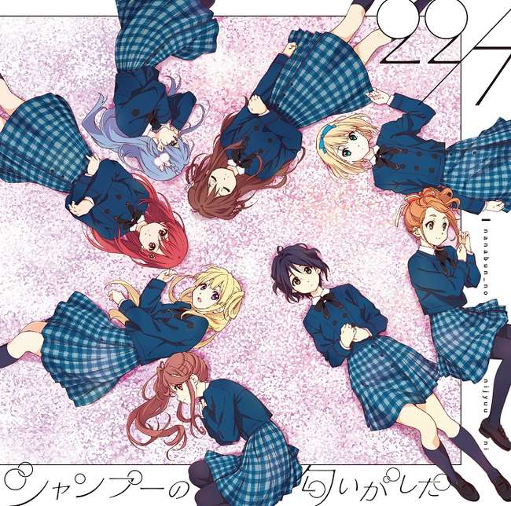

# :pack-hires: 循环巴士

!!! general inline end "歌曲信息"

    === "完全生产限定版Type-A"
        
    === "完全生产限定版Type-B"
        
    --------
    
    <b>歌曲名称:</b> 循环巴士

    --------

    <b>日文名称:</b> 循環バス

    ---------
    
    <b>类型:</b> 歌曲

    --------
    
    <b>发行日期:</b> 2018年4月11日

    --------

    <b>收录专辑:</b> 《シャンプーの匂いがした》

    --------

    <b>制作人:</b> 秋元康

    --------

    <b>作词:</b> 秋元康

    --------

    <b>作曲:</b> Kensuke Toyoda

    --------

    <b>编曲:</b> Takahiro Furukawa

    --------

    <b>时长:</b> 4:27
 
    --------

    <b>排行榜:</b> Oricon周榜第八名
    
    --------

    <b>发行公司:</b> Sony Music Records

## 简介

《循环巴士》是收录在22/7第2张单曲《散发出了香波的气息》通常盘中的曲目，作词由秋元康负责，作曲由Kensuke Toyoda负责，编曲由Takahiro Furukawa负责，单曲于2018年4月11日正式发售，总时长4分27秒，首周取得了Oricon周榜第八名的位置。

=== "振付映像"
    <iframe src="https://player.bilibili.com/player.html?aid=509643004&bvid=BV1tu411B7Si&cid=1477490777&p=1&autoplay=0" autoplay="0" scrolling="no" border="0" frameborder="no" framespacing="0" allowfullscreen="true" width="100%" height="720"> </iframe>
    [:pack-bili-tv: 前往bilibili观看](https://www.bilibili.com/video/BV1tu411B7Si){ .md-button .md-button--primary }
    [:fontawesome-brands-youtube: 前往YouTube观看](https://www.youtube.com/watch?v=AOjhCli-uh0){ .md-button .md-button--primary }

## 歌词

=== "日语"
    

    いつものバスが角を曲がって

    春の坂を登れば

    女子校前の停留所から

    君が乗って来るんだ

    何度か偶然　見かけるうちに

    僕は虜になった

    明日も会いたいなんて　生まれて初めての気持ち

    グレーの制服の君が眩(まぶ)しくて…

    名前さえも知らないけど　一緒に帰れればいい

    夕焼けが美しすぎて　切ないよ

    僕の心をぐるぐる回る

    恋の循環バスさ

    毎日　バスは同じコースで

    景色も見飽きてるけど

    駅に着くまで10分間が

    僕は楽しみなんだ

    目と目が合って　ほんの一瞬

    君が微笑んだような…

    朝は何時に乗るのか　ホントは聞いてみたかった

    声を掛ける勇気があればいいのに…

    行きも帰りも会えたら付き合ってるみたいだね

    ガタンと揺れたって君は遠すぎて

    卒業するまで二人　この距離で

    青春　循環バスか

    ゆっくりと歳月(とき)は流れ　僕たちは大人になる

    晴れの日も雨の日もバスは行く

    もどかしい季節は終点がないまま

    ぐるぐると回るだけ

    明日も会いたいなんて　生まれて初めての気持ち

    グレーの制服の君が眩(まぶ)しくて…

    名前さえも知らないけど　一緒に帰れればいい

    夕焼けが美しすぎて　切ないよ

    僕の心をぐるぐる回る
    
    恋の循環バスさ

=== "翻译"
    

    翻译来源：227中文应援会

    一如既往的巴士 行驶过转角

    登上春天的坂道

    看见你从女子校前的车站

    乘车驶来

    只是几次偶然相遇

    我便被你俘虏

    「明天也想遇见你」 生来第一次有了这样的心情

    身着灰色制服的你无比耀眼……

    即使连你的名字也还不知道 能一起回家就已经满足

    太过美丽的夕阳 透露出了悲伤

    就像是让我的心一圈圈回转的

    恋爱的循环巴士

    每天巴士都沿着一样的线路

    途中的景色也已经厌倦

    但到站前的十分钟

    总是让我很期待

    目光交接的一瞬间

    你露出了微笑吧……

    你早上会搭几点的车呢 其实真的很想问问你

    如果我有向你搭话的勇气就好了呢……

    来与回都能够遇见你的话 就有点像在交往一样了呢

    在摇晃的车间中的你离得太远

    在毕业之前就保留着这个距离吧

    青春的循环巴士

    歳月は流れ 随着岁月缓缓流逝 我们也将转为大人

    不管是晴天和雨天巴士也照常行驶

    这令人焦躁的季节却看不到终点

    只是在一圈圈环行

    「明天也想遇见你」 生来第一次有了这样的心情

    身着灰色制服的你无比耀眼……

    即使连你的名字也还不知道 能一起回家就已经满足

    太过美丽的夕阳 透露出了悲伤

    就像是让我的心一圈圈回转的

    恋爱的循环巴士
    

