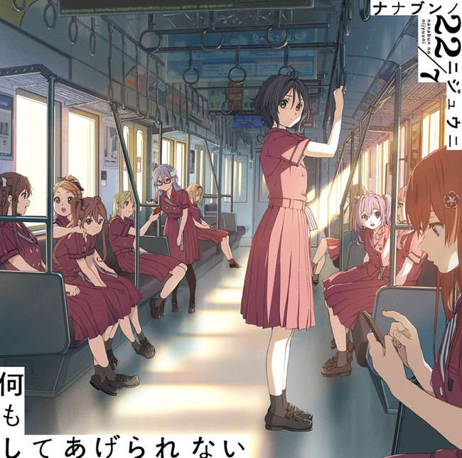
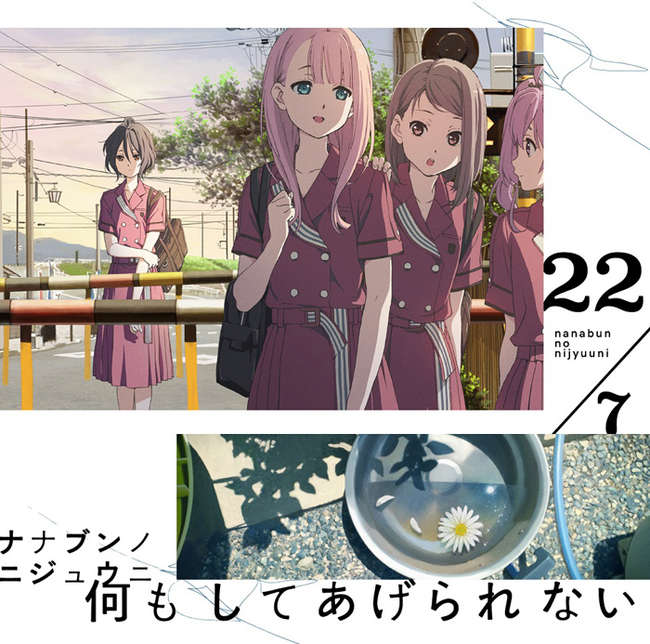
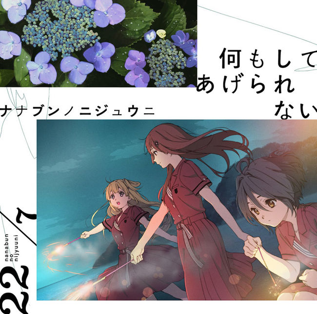

---
title: 歌曲 -  你是月亮
template: comment.html
---
# :pack-hires: 你是月亮

!!! general inline end "歌曲信息"

    === "完全生产限定盘 Type-A"
        
    === "完全生产限定盘 Type-B"
        
    === "通常盘"
        
    --------
    
    <b>歌曲名称:</b> 你是月亮

    --------

    <b>日文名称:</b> 君は Moon

    ---------
    
    <b>类型:</b> 歌曲

    --------
    
    <b>发行日期:</b> 2019年8月21日

    --------

    <b>收录专辑:</b> 《何もしてあげられない》

    --------

    <b>制作人:</b> 秋元康

    --------

    <b>作词:</b> 秋元康

    --------

    <b>作曲:</b> Kenichi Anraku / TomoLow / KIKI / Ryo Ito

    --------

    <b>编曲:</b> TomoLow

    --------

    <b>时长:</b> 3:48
 
    --------

    <b>排行榜:</b> Oricon日榜、周榜第四名
    
    --------

    <b>发行公司:</b> Sony Music Records

## 简介

《你是月亮》是收录在22/7第4张单曲《什么都无法为你做到》中的共通曲，作词由秋元康负责，作曲由Kenichi Anraku、TomoLow、KIKI、Ryo Ito负责，编曲由TomoLow负责，单曲于2019年8月21日正式发售，总时长3分48秒，取得了Oricon日榜、周榜第四名的位置。

## 歌词

=== "日语"
    

    月を見ていた少年時代

    地球からどれくらい遠いか知らなかった

    ロケットの絵を描(か)いて想像を膨らませてた

    買ってもらった望遠鏡で

    宇宙の向こう側のもう一つの世界に

    憧れた(なりたかった)夢は宇宙飛行士

    大人になった僕は(大人になった僕は)

    まだ地球にいるよ(地球にいるよ)

    夜の空見上げながら

    いつか一緒に行こうって

    肩を並べ語った

    君はMoon

    僕はEarth

    いつの日か恋をして

    知らぬ間にこんな近づいた

    僕たちは月と地球だ

    ロケットなんか

    使わなくても　たどり着けたよ

    愛は離れたその距離

    家を出てから何年間も

    空なんか見上げずに下を向いて歩いた

    日常のことだけで頭の中いっぱいだった

    ビルに囲まれた大気圏は

    大事な何かさえも忘れてしまうくらい

    忙しく(働いてた)僕はサラリーマンだ

    ある日　出会った君と(ある日　出会った君と)

    初めてデートして(デートして)

    輝いた星座の中

    きっと運命が巡って

    惹かれ合い　ここにいる

    僕のMoon

    君のEarth

    少しずつ　欠けて行き

    またここで姿現した

    美しい青い満月

    時間(とき)を超えて

    やっとここまで　届いた愛だ

    たとえどんなに離れてても…

    月面には待ってくれてる

    生命体はいるのだろうか？

    さあ未来を話そう

    君はMoon

    僕はEarth

    いつの日か恋をして

    知らぬ間にこんな近づいた

    僕たちは月と地球だ

    ロケットなんか

    使わなくても　たどり着けたよ
    
    愛は離れたその距離

=== "翻译"
    

    翻译来源：_緑袖子

    少年时代常凝望着月亮

    根本不知道它距离 地球有多么的遥远

    在画纸上描绘着火箭 任由想像驰骋蔓延

    用你买给我的望远镜观测

    一直都憧憬着宇宙另一端的那个世界

    我曾经的梦想就是成为宇航员

    长大成人后的我（长大成人后的我）

    依然生活在地球上（生活在地球上）

    我们就这样肩并肩 仰望着夜空说道终有一天

    要一同前往那里

    你如月亮 我如地球

    未来某天会坠入爱河

    我们便是在不知不觉间彼此

    靠近的月亮和地球

    即便不依靠火箭

    之类的工具依然能够抵达吧

    爱就在这相隔的距离中

    在离开家之后已经好多年

    没有抬头仰望过天空 总是低着头往前走

    充斥着整个脑海的 全是和日常有关的事情

    身处大楼所包围的大气层

    就连重要的事物都已经完全忘却了

    我是个上班族 每天的工作忙碌不堪

    在那天 和邂逅的（你在那天 和邂逅的你）

    第一次出去约会（出去约会）

    在熠熠生辉的星座中 一定是因为命运的轮回

    而彼此吸引 才身处于这里

    我如月亮 你如地球

    一点一点地开始亏缺

    然后重新出现在这里

    美好而苍蓝的满月

    超越了时间

    辗转不易抵达这里的那份爱恋

    不论相隔的距离有多遥远

    是否会有所谓的生命体

    在月球表面等待着我呢 让我们畅谈未来吧

    你如月亮 我如地球

    未来某天会坠入爱河

    我们便是在不知不觉间彼此

    靠近的月亮和地球

    即便不依靠火箭

    之类的工具依然能够抵达吧

    爱就在这相隔的距离中
    

