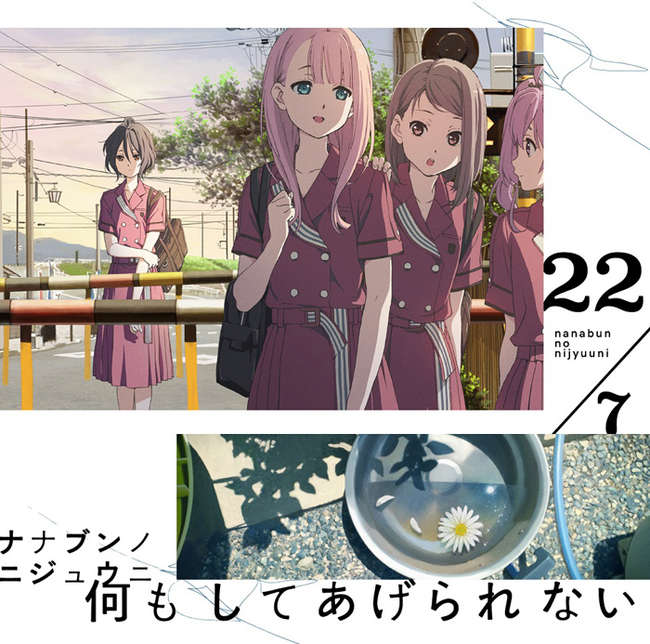

---
title: 歌曲 -  浪漫积木
template: comment.html
---
# :pack-hires: 浪漫积木

!!! general inline end "歌曲信息"

    === "完全生产限定盘 Type-A"
        
    === "完全生产限定盘 Type-B"
        
    === "通常盘"
        
    --------
    
    <b>歌曲名称:</b> 浪漫积木

    --------

    <b>日文名称:</b> ロマンスの積み木

    ---------
    
    <b>类型:</b> 歌曲

    --------
    
    <b>发行日期:</b> 2019年8月21日

    --------

    <b>收录专辑:</b> 《何もしてあげられない》

    --------

    <b>制作人:</b> 秋元康

    --------

    <b>作词:</b> 秋元康

    --------

    <b>作曲:</b> Takeshi Kitamura / Yoichi Tanoue

    --------

    <b>编曲:</b> Takeshi Kitamura / Yoichi Tanoue

    --------

    <b>时长:</b> 4:50
 
    --------

    <b>排行榜:</b> Oricon日榜、周榜第四名
    
    --------

    <b>发行公司:</b> Sony Music Records

## 简介

《浪漫积木》是收录在22/7第4张单曲《什么都无法为你做到》完全生产限定盘Type-B中的曲目，作词由秋元康负责，作曲和编曲由Takeshi Kitamura、Yoichi Tanoue负责，单曲于2019年8月21日正式发售，总时长4分50秒，取得了Oricon日榜、周榜第四名的位置。

## 歌词

=== "日语"
    

    ロマンス　指で触れてしまうだけで

    ガラガラ　崩れ落ちて行く積み木

    出会ったばかりの恋人たちは

    ただ傷つくことに　お互いに怯えて

    心の手前で手探りしながら

    永遠の恋を　信じたくなるよ

    そんな奇跡を近くで見てれば

    答えの積み木が一つ一つ積まれて行く

    ロマンス　急がなくてもいい　二人

    自分で納得できたら　いつか

    やさしさだけでは完成しないよ

    そう厳しい声も　耳に届くはず

    「本当にアイシテル」

    冷静になれたその時　気持ちがわかるだろう

    どんなものより　大切だと知る

    ロマンス

    いつ崩れるのか　怯えていては

    愛し合うなんて絶対に無理だよ

    自分の気持ちに正直でなきゃ

    相手の気持ちも信じられないさ

    言葉や仕草　些細なヒントで

    見えない積み木がいつの間にか積まれているんだ

    メモリー　何も考えずに　ずっと

    感情　ぶつけて来たから　今は

    無意識の愛の形ができてる

    ねえ　無理をしないで一緒にいたいよ

    「僕たちの愛は積み木だ」

    一瞬の情熱よりも　継続が大事なんだ

    もし壊れたら　また積み上げよう

    メモリー

    積み木よ　いつまでもそこにいてくれ

    何度か　崩れることがあっても…

    諦めることは　絶対にないよ

    また一から　同じように愛すだけ

    ロマンス　急がなくてもいい　二人

    自分で納得できたら　いつか

    やさしさだけでは完成しないよ

    そう厳しい声も　耳に届くはず

    冷静になれたその時　気持ちがわかるだろう

    どんなものより　大切だと知る
    
    ロマンス

=== "翻译"
    

    翻译来源：_緑袖子

    Romance 只是用手指碰触了之后

    摇摇欲坠 然后积木在顷刻间坍塌

    刚刚彼此邂逅的那些恋人

    都在惧怕着可能 伤害到对方

    在真心面前伸出手不断摸索

    却不愿相信 会有永恒的爱恋

    若是近距离去看那样的奇迹

    答案就会如积木一点一点地累积而起

    Romance 两人不需那么步履匆匆

    终有一天若自己能够明白

    只是付出温柔的话是做不到的

    应该就能听到那 如此冷酷的声音

    我真的很爱你

    在冷静下来的时候 就能明白这样的心情了吧

    并且能够知晓什么才是胜于一切的重要之物

    Romance

    会在何时崩塌呢 始终有所畏惧

    这样是绝对没办法好好去爱彼此的啊

    若是不能正视自己的心情

    就更无法相信对方的心意了

    不论话语还是动作 都在给予我们微弱的提示

    那无形的积木 早在不觉间悄然堆积起来了

    Memory 一直以来什么都不曾思考过

    这份感情一路跌跌撞撞 到了今时今刻

    无意之间这份爱就此成形

    呐 不要再勉强自己了 我想要和你在一起

    我们之间的爱宛如积木

    比起一瞬间的热情 让它得以延续才最重要

    若是积木坍塌 那么就重新堆砌吧

    Memory

    积木啊 永远就这样陪伴在我身边吧

    无数次 即便会有濒临崩溃的时候

    依然不会轻易就选择放弃吧

    只需从头开始 依然选择这么爱着对方

    Romance 两人不需那么步履匆匆

    终有一天若自己能够明白

    只是付出温柔的话是做不到的

    应该就能听到那如此冷酷的声音

    在冷静下来的时候 就能明白这样的心情了吧

    并且能够知晓什么才是 胜于一切的重要之物

    Romance
    

