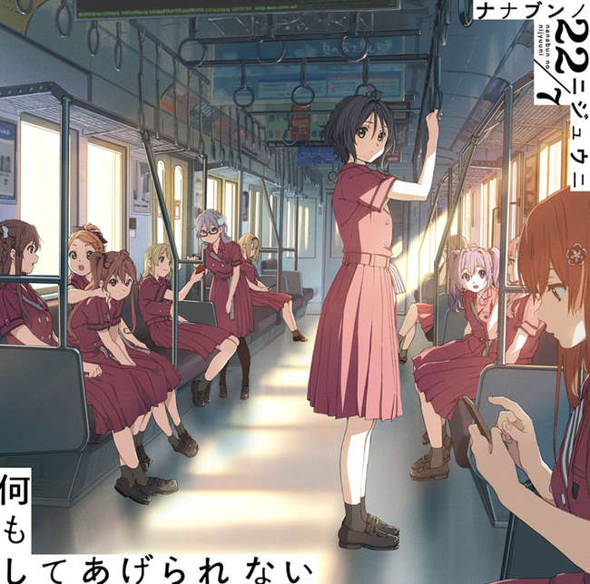
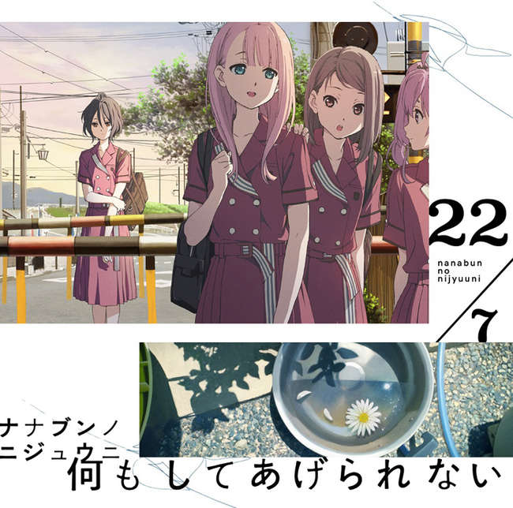

---
title: 歌曲 -  谎言之雨
template: comment.html
---
# :pack-hires: 谎言之雨

!!! general inline end "歌曲信息"

    === "完全生产限定盘 Type-A"
        
    === "完全生产限定盘 Type-B"
        
    === "通常盘"
        
    --------
    
    <b>歌曲名称:</b> 谎言之雨

    --------

    <b>日文名称:</b> Rain of Lies

    ---------
    
    <b>类型:</b> 歌曲

    --------
    
    <b>发行日期:</b> 2019年8月21日

    --------

    <b>收录专辑:</b> 《何もしてあげられない》

    --------

    <b>制作人:</b> 秋元康

    --------

    <b>作词:</b> 秋元康

    --------

    <b>作曲:</b> Itsuki Onagi

    --------

    <b>编曲:</b> Itsuki Onagi

    --------

    <b>时长:</b> 4:46
 
    --------

    <b>排行榜:</b> Oricon日榜、周榜第四名
    
    --------

    <b>发行公司:</b> Sony Music Records

## 简介

《谎言之雨》是收录在22/7第4张单曲《什么都无法为你做到》通常盘中的曲目，作词由秋元康负责，作曲和编曲由Itsuki Onagi负责，单曲于2019年8月21日正式发售，总时长4分46秒，取得了Oricon日榜、周榜第四名的位置。

## 歌词

=== "日语"
    

    好きな人がついた嘘は

    ふいに降り出した雨に似ている

    そんなわけがないと空を見上げるように

    ただ　あなたをもう一度

    じっと見つめてしまった

    真っ黒な雲に覆われて

    愛しさの夕立　ずぶ濡れになったまま

    何も言い返せずに　立ち尽くしていた

    どうすればいいのだろう　(傘もない)

    Wowow この恋の夕立　雨脚が強すぎて

    街から音が消えて　前も見えにくくなって

    孤独だった

    ここで背中を向けられるのか？

    サヨナラって言い出せるのか？

    どっちもどっち

    Rain of lies

    やがて光が差すように

    ごめんねと言ってくれるのだろうか？

    心とアスファルト叩きながら

    もうこれ以上話しても

    空模様は変わらない

    悲しみは水溜りになる

    思い出が泣いている　目の前が滲んでく

    否定してくれるって期待してたのに

    私って甘すぎるね　(馬鹿みたい)

    Wowow この雨が上がれば　明日から晴れるかな

    涙が乾く頃に　すべてを忘れられる虹もかかる

    それも人生の一コマなんだ

    そっと自分に言い聞かせた

    終わった恋は

    Rain of lies

    雨も気にならなくなって来た

    愛しさの夕立　ずぶ濡れになったまま

    何も言い返せずに　立ち尽くしていた

    どうすればいいのだろう　(傘もない)

    Wowow この恋の夕立　雨脚が強すぎて

    街から音が消えて　前も見えにくくなって

    孤独だった

    ここで背中を向けられるのか？

    サヨナラって言い出せるのか？

    どっちもどっち
    
    Rain of lies

=== "翻译"
    

    翻译来源：_緑袖子

    心爱之人编织出的谎言

    就好似纷纷的落雨 毫无预兆落下

    一切根本就不需理由 就像抬头仰望天空般

    只是就这样再一次 静静地看着你的模样

    漆黑的乌云将我笼罩

    这爱的骤雨 让我浑身上下都已湿透

    对于你的沉默不语 我愣在了原地

    究竟该如何是好呢(并没有带伞)

    这场恋爱骤雨 雨势是如此强劲

    整条街道被雨声淹没 就连前方都难以看得清晰 感觉如此孤独

    我是否可以毫无留恋地转身

    还是可以轻易将再见脱口而出

    好像都做不到 谎言交织如雨

    仿佛不久后便会阳光普照

    你是否会 对我说出那句抱歉呢

    这场雨拍打着我的心以及柏油马路

    就算再去说些什么 现状也不会改变

    悲伤堆积成了水洼

    回忆在不住地哭泣 慢慢渗透于眼前

    你给了我否定的回答 明明曾如此期待

    是我过分依赖你了啊（真像个笨蛋）

    若是这场雨停下 明天就会放晴了吧

    待泪水干涸时 就能将一切全都忘记 彩虹也会随之出现

    这些不过是人生的一段经历而已

    我这么轻声地安慰着自己

    这份爱已经落幕 谎言交织如雨

    已经全然不去在意这场雨了

    这爱的骤雨 让我浑身上下都已湿透

    对于你的沉默不语 我愣在了原地

    究竟该如何是好呢 （并没有带伞）

    这场恋爱骤雨 雨势是如此强劲

    整条街道被雨声淹没 就连前方都难以看得清晰 感到如此孤独

    我是否可以毫无留恋地转身

    还是可以轻易将再见脱口而出

    好像都做不到 谎言交织如雨
    

