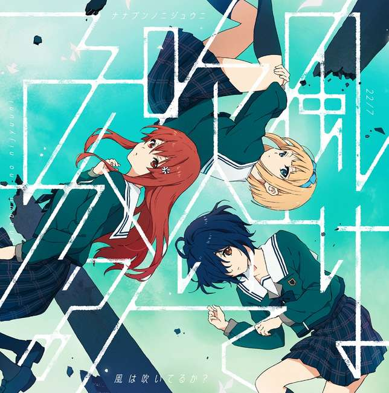
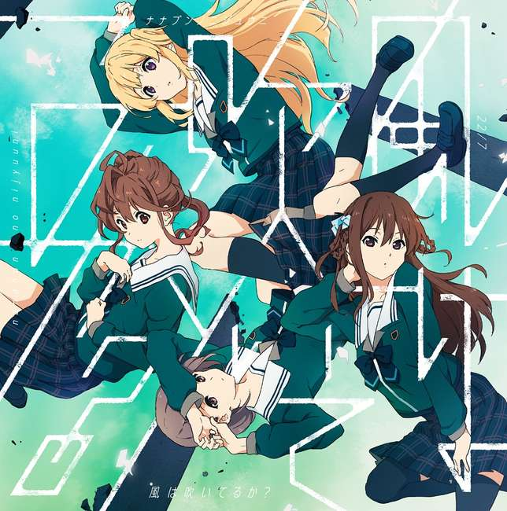
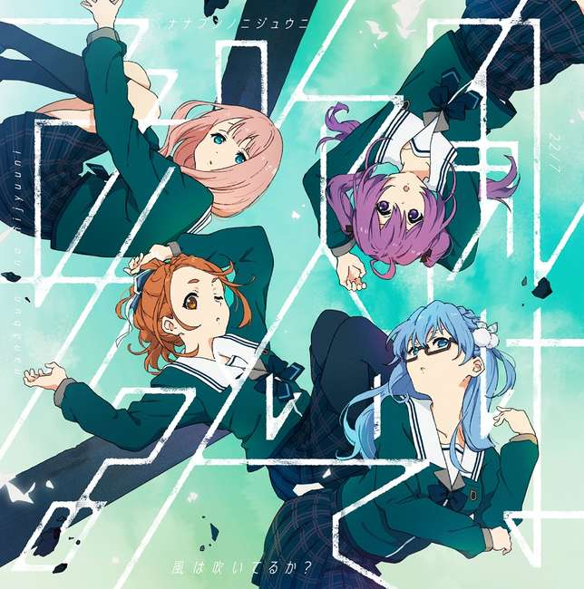

---
title: 歌曲 -  马尾别转身
template: comment.html
---
# :pack-hires: 马尾别转身

!!! general inline end "歌曲信息"

    === "完全生产限定盘"
        
    === "完全盘"
        
    === "通常盘"
        
    --------
    
    <b>歌曲名称:</b> 马尾别转身

    --------

    <b>日文名称:</b> ポニーテールは振り向かせない

    ---------
    
    <b>类型:</b> 歌曲

    --------
    
    <b>发行日期:</b> 2020年9月30日

    --------

    <b>收录专辑:</b> 《风在吹吗?》

    --------

    <b>制作人:</b> 秋元康

    --------

    <b>作词:</b> 秋元康

    --------

    <b>作曲:</b> Daishi Suzuki

    --------

    <b>编曲:</b> Daishi Suzuki

    --------

    <b>时长:</b> 4:37
    
    --------

    <b>发行公司:</b> Sony Music Records

## 简介

《马尾别转身》是收录在22/7第6张单曲《风在吹吗?》中的共通曲，也是游戏《22/7 音楽の時間》中“SUMMER x SUMMER x SUMMER”活动的主题曲，作词由秋元康负责，作曲、编曲由Daishi Suzuki负责，单曲于2020年9月30日正式发售，总时长4分37秒。

## 歌词

=== "日语"
    

    もう　木陰が　なくなってしまったくらい

    そう　校庭を照らしている夏の太陽

    真っ白なシャツの背中が汗で濡れて

    肩で息をつく君が愛おしかった

    何て声を掛ければいい　思い切り抱きしめたい

    心は叫びながら

    不器用な恋をしていた

    「君が好きだ」

    振り向かせなくても　必ず想いは伝わる

    ポニーテールだけ見つめて

    君を遠くから　遠くから好きでいる

    もし目と目が合ったら　どうすればいいかわからない

    きっと無様な僕になる

    存在に気づいていない方が

    お互い自由でいられるだろう

    もう少し勝手に好きでいさせて

    ああ　このまま　あとどれくらいここにいれば

    そう　蜩(ひぐらし)が下校時刻　教えるだろう？

    グラウンドは誰もいなくなってしまった

    僕は呆然とそこに立ち尽くしていた

    君と帰りたかったんだ　夕暮れの商店街

    自転車　押して歩く

    甘酸っぱい恋の妄想

    「夢を見ていた」

    振り向かせようとは　思ってなんかいないんだ

    結んだリボン　眺めながら

    今の関係で　関係で構わない

    ２人が向き合ったら　何を話せばいいのだろう？

    絶対　無口な僕になる

    愛しさに気づかれてない方が

    誰だって自然に振る舞えるもの

    卒業をするまで好きでいさせて

    「片想いでいいんだ」

    振り向かせなくても　必ず想いは伝わる

    ポニーテールだけ見つめて

    君を遠くから　遠くから好きでいる

    もし目と目が合ったら　どうすればいいかわからない

    きっと無様な僕になる

    存在に気づいていない方が

    お互い自由でいられるだろう

    もう少し勝手に好きでいさせて
=== "翻译"
    

    翻译来源：某跑腿工pk君

    树荫都快要消失般

    夏日炙烤着校园

    白衬衫的背后浸满了汗

    慌乱着喘息的你 特别可爱

    我烦恼怎么向你搭话 想要尽情抱紧你

    心底呐喊着

    笨拙地爱着

    我喜欢你

    不需要你回头 我的思念会传达给你

    只要看着你的单马尾

    远远地 远远地爱着你

    如果对上了你的眼神 我该怎么办 我不知道

    我定会不知所措

    还是不要注意到我的存在

    才能保持你我的自由

    让我再任性喜欢你一会吧

    这样下去 我还能停留在这里多久

    蝉鸣会传来放学的时间吧

    操场上已经不见人影

    只剩我一个人 呆呆地立着

    多想和你一起回去 在黄昏的商店街

    自行车 边推边走

    甜蜜的酸楚 恋爱的妄想

    「我梦见了」

    我从未想过 让你回头看看我

    望着你系好的缎带

    我们如今的关系 不需要在意

    如果我面对了你 我该说些什么

    我必会缄口不言

    还是不要察觉到我的怜爱

    才能让所有人都能自然地演出

    让我再喜欢你直到毕业吧

    「只要我单相思就好」

    不需要你回头 我的思念会传达给你

    只要看着你的单马尾

    远远地 远远地爱着你

    如果对上了你的眼神 我该怎么办 我不知道

    我定会不知所措

    还是不要注意到我的存在

    才能保持你我的自由

    让我再任性喜欢你一会吧
    

