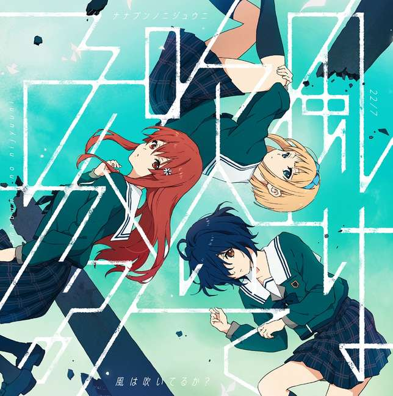
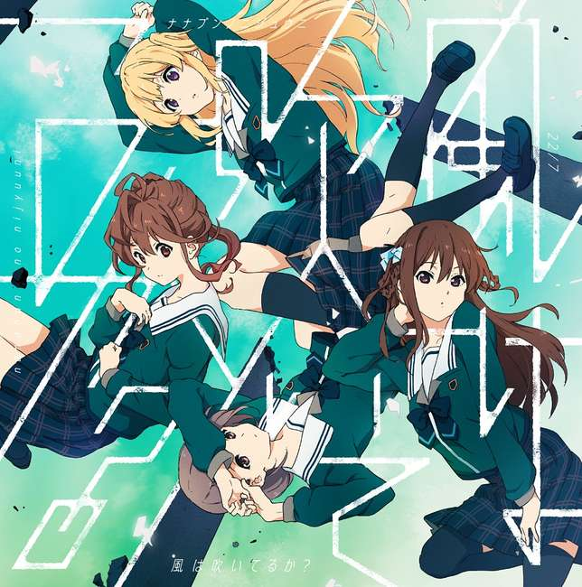
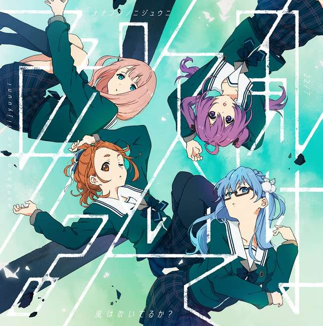

---
title: 歌曲 -  纹身·爱
template: comment.html
---
# :pack-hires: 纹身·爱

!!! general inline end "歌曲信息"

    === "完全生产限定盘"
        
    === "完全盘"
        
    === "通常盘"
        
    --------
    
    <b>歌曲名称:</b> 纹身·爱

    --------

    <b>日文名称:</b> タトゥー・ラブ

    ---------
    
    <b>类型:</b> 歌曲

    --------
    
    <b>发行日期:</b> 2020年9月30日

    --------

    <b>收录专辑:</b> 《风在吹吗?》

    --------

    <b>制作人:</b> 秋元康

    --------

    <b>作词:</b> 秋元康

    --------

    <b>作曲:</b> Saqui / Konnyaku Nishino

    --------

    <b>编曲:</b> Saqui

    --------

    <b>时长:</b> 3:44
    
    --------

    <b>发行公司:</b> Sony Music Records

## 简介

《纹身·爱》是收录在22/7第6张单曲《风在吹吗?》完全生产限定盘中的收录曲，作词由秋元康负责，作曲由Saqui、Konnyaku Nishino负责，编曲由Saqui负责，单曲于2020年9月30日正式发售，总时长3分44秒。

## 歌词

=== "日语"
    

    追いかけられてたはずなのに

    いつしか　あなたを見失った

    知らないうちに　私のこと

    もう　興味さえなくなってしまったの？

    きっと　恋の曲がり角で

    あなたは一人曲がったんでしょう？

    ずっとこのまま　一緒に来るって

    思い込んでいた

    なんてバカな意地を張って

    勝手な自惚れ　プライド　後悔

    人間(ひと)の気持ちは　いつも

    永遠じゃない　全部　幻

    ねえ　思い出して

    この一本道

    ずっと歩いて来たロマンスを…

    ねえ　忘れたなんて　絶対　言って欲しくない

    ハートに残ったタトゥー・ラブ

    だって　そう　自信がなかったの　本物かって…

    そうよ　ただ一瞬の情熱だわ

    ねえ　振り返ったって　ちゃんと　いつもそこにいて

    ハートに消えないタトゥー・ラブ

    愛されるなんて不確かで

    視線の強さを誤解してた

    言葉とか行動とか

    そう　明確な根拠などなかったのに…

    あれは　風の仕業でしょう

    ずっと背後(うしろ)に聴こえた足音

    ある日　突然消えた

    現実じゃない　愛の蜃気楼

    もう　振り向かない

    この記憶の道

    いつか　存在した物語

    そう　今もこの胸の　奥の愛しさに気づく

    痛みは　タトゥー・ラブ

    「覚えているわ」

    「愛に傷ついた」

    「でも後悔してない」

    「過去に刻まれたもの」

    ねえ　思い出して

    この一本道

    ずっと歩いて来たロマンスを…

    ねえ　忘れたなんて　絶対　言って欲しくない

    今でも夢見る証拠

    タトゥー

    だって　そう　自信がなかったの　本物かって…

    そうよ　ただ一瞬の情熱だわ

    ねえ　振り返ったって　ちゃんと　いつもそこにいて

    ハートに消えないタトゥー・ラブ
=== "翻译"
    

    翻译来源：云贝猎人Water

    原本一直紧紧跟着

    不知什么时候跟丢了你

    不知道么时候

    你已经对我不感兴趣了么

    一定是在恋爱的转角

    你一个人过去了吧

    我本以为我们会一直

    在一起

    赌多么傻的气

    任性的自我陶醉 自尊 后悔

    人的感受一直都不是

    一成不变的 全部都是幻想

    啊 回想一下

    这条直路

    一直走过来的浪漫

    啊 忘了什么的 我一定不想你这么说

    在心中刻下的love纹身

    但是 对 以前不确定是不是真心

    是 只是一时的热情

    你看 回首过往 那确实有

    在心中有无法消逝的love纹身

    被爱什么的不确切

    误解了要强的视线

    语言 行动什么的

    对 没有确切的根据

    那是风在作怪吧

    一直在背后的脚步声

    有一天突然消失了

    不是现实 爱的海市蜃楼

    不要再回头了

    这条记忆的道路

    曾经存在过的故事

    是的 现在察觉到了内心里的爱

    痛是love纹身

    「我记得」

    「为爱受伤」

    「但是不后悔」

    「被刻在了过去」

    啊 回想一下

    这条直路

    一直走过来的浪漫

    啊 忘了什么的 我一定不想你这么说

    现在也在做梦的证据

    纹身

    但是 对 以前不确定是不是真心

    是 只是一时的热情

    你看 回首过往 那确实有

    在心中刻下的love纹身
    

