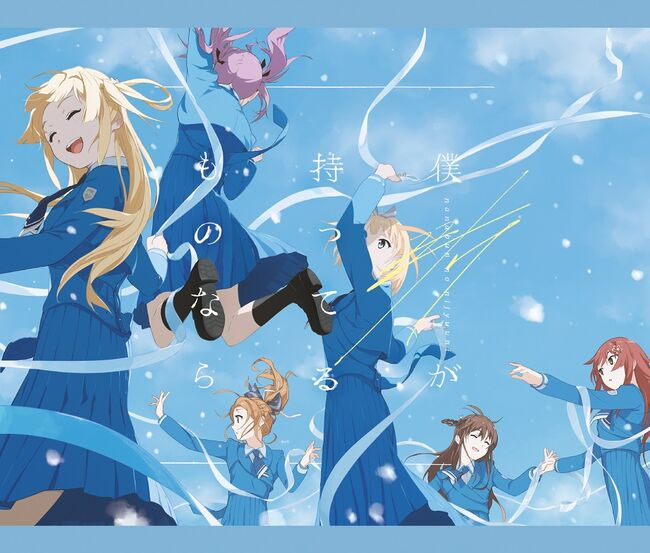
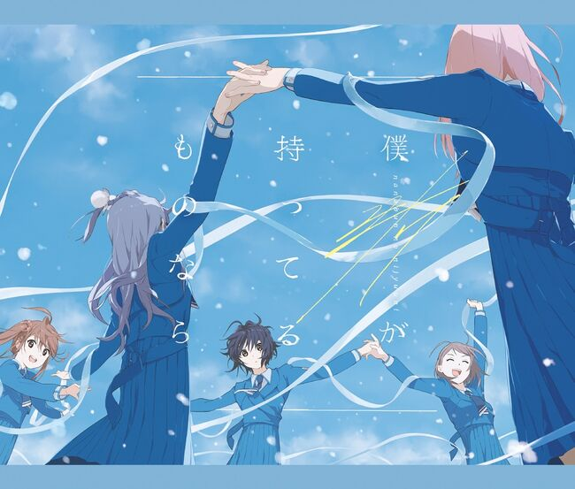
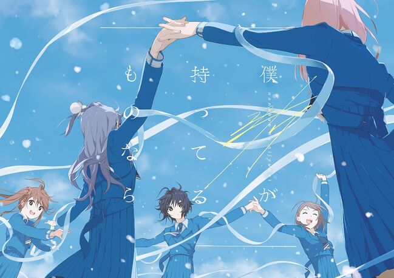
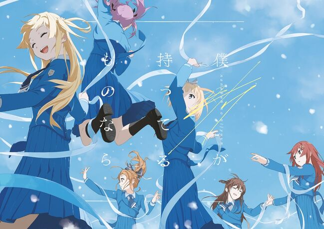

# :pack-hires: 若是我的所有之物

!!! general inline end "歌曲信息"

    === "完全生产限定盘 Type-A"
        
    === "完全生产限定盘 Type-B"
        
    === "初回规格限定盘"
        
    === "通常盘"
        
    --------
    
    <b>歌曲名称:</b> 若是我的所有之物

    --------

    <b>日文名称:</b> 僕が持ってるものなら

    ---------
    
    <b>类型:</b> 歌曲

    --------
    
    <b>发行日期:</b> 2021年2月24日

    --------

    <b>收录专辑:</b> 《若是我的所有之物》

    --------

    <b>制作人:</b> 秋元康

    --------

    <b>作词:</b> 秋元康

    --------

    <b>作曲:</b> OzaShin

    --------

    <b>编曲:</b> Nonaka "Masa" Yuichi

    --------

    <b>时长:</b> 4:43
    
    --------

    <b>发行公司:</b> Sony Music Records

## 简介

《若是我的所有之物》是收录在22/7第7张单曲《若是我的所有之物》中的同名主打曲，也是游戏《22/7 音楽の時間》中“Holy Night's Trouble Gift”活动的主题曲，作词由秋元康负责，作曲由OzaShin负责，编曲由Nonaka "Masa" Yuichi负责，单曲于2021年2月24日正式发售，总时长4分43秒。

=== "Music Video"
    <iframe src="https://player.bilibili.com/player.html?aid=1404666374&bvid=BV1jr421j7PH&cid=1544135359&p=1&autoplay=0" autoplay="0" scrolling="no" border="0" frameborder="no" framespacing="0" allowfullscreen="true" width="100%" height="720"> </iframe>
    [:pack-bili-tv: 前往bilibili观看](https://www.bilibili.com/video/BV1jr421j7PH){ .md-button .md-button--primary }
    [:fontawesome-brands-youtube: 前往YouTube观看](https://www.youtube.com/watch?v=wfhOmvXL0i0){ .md-button .md-button--primary }

## 歌词

=== "日语"
    

    僕が持ってるものなら

    分けてあげられるけど

    なぜか君が求めてるものだけ

    持ってないんだ

    道の上に倒れていた

    君のことを助けたかった

    どんな運命（さだめ）に流されて

    どこを彷徨（さまよ）って来たのか？

    僕の瞳（め）をじっと見て

    大きく首を横に振り

    宙（ちゅう）を睨みつけ

    涙がふいに溢れ出す

    僕が持ってるものなら

    全部あげたっていい

    それで君が泣き止んで

    微笑んでくれればいい

    僕が持ってるものなら

    たった一つのものでも

    この世に生まれた命の意味と

    交換しよう

    （間奏）

    どこで雨に打たれたのか？

    どこで風に吹かれてたのか？

    屋根さえない寒い場所で

    誰を恨んでいたのか？

    人間（ひと）は皆、平等だと

    神様から聞かされたって

    絶望ばかりして

    夢は見ないって誓ったんだ

    僕が持ってるものなら

    全部あげたっていい

    それで君が泣き止んで

    微笑んでくれればいい

    僕が持ってるものなら

    たった一つのものでも

    この世に生まれた命の意味と

    交換しよう

    （間奏）

    何をすれば人間（ひと）として

    胸を張って生きられるのか？

    何度も問いかけてる

    やさしさなんて偽善だろう

    僕は何を持っていて

    何を持ってないのか？

    それが当たり前だった

    しあわせなんかいらない

    僕は何を持っていて

    何を失ったのだろう？

    君に何かを与えられるなら

    愛しかない

    僕が持ってるものなら

    分けてあげられるけど

    なぜか君が求めてるものだけ

    持ってないんだ…
=== "翻译"
    

    翻译来源：Tap桜良

    若是我的持有之物

    便能交付与你

    却唯独没有

    你所追求的东西

    是如此想去帮助

    跌倒在路上的你

    被何种命运翻弄

    从何处彷徨而来

    你看着我的眼

    摇着头示意拒绝

    抬头仰望天空

    无意之间流下泪水

    若是我的持有之物

    甘愿献出全部

    只要你不再哭泣

    露出微笑就好

    若是我的持有之物

    哪怕仅此唯一

    去用其交换

    世间生命之意义

    在何处被雨打稀

    在何处被风吹尽

    在寒冷无檐之处

    内心中记恨于谁

    神说众生平等

    不过是无言之物

    现实只有绝望

    发誓不抱有梦想

    若是我的持有之物

    甘愿献出全部

    只要你不再哭泣

    露出微笑就好

    若是我的持有之物

    哪怕仅此唯一

    去用其交换

    世间生命之意义

    要如何才能活出

    生而为人的尊严

    不断追寻答案

    温柔只不过是伪善

    我究竟拥有什么？

    又究竟缺少什么？

    理所当然的幸福

    我却并不需要

    我究竟拥有什么？

    又究竟失去什么？

    我能给你的

    或许只有这份爱

    若是我的持有之物

    便能交付与你

    却唯独没有

    你所寻找的东西
    

