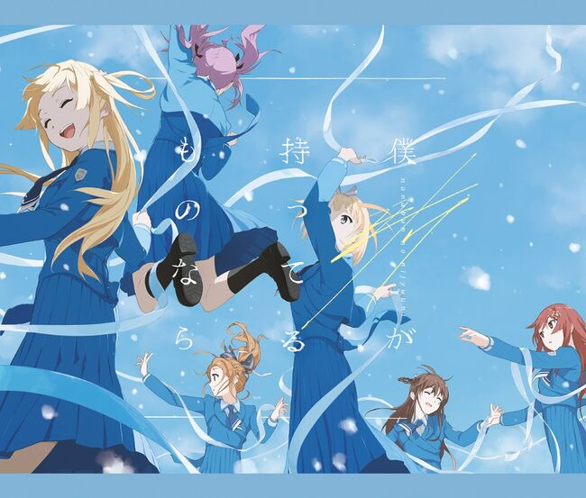
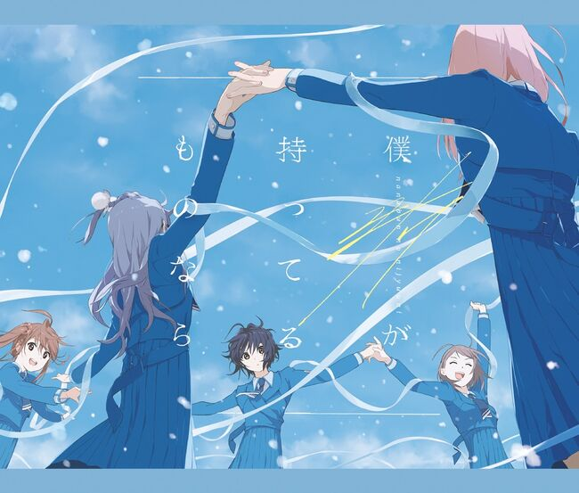
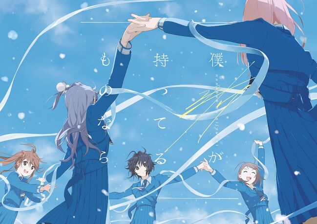
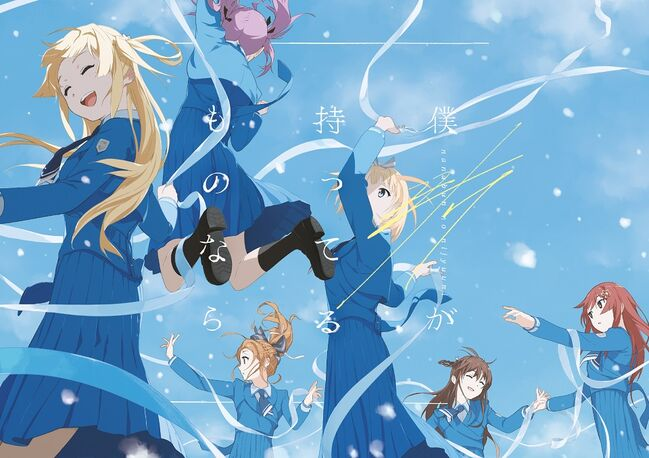

---
title: 歌曲 -  说喜欢是骗人的
template: comment.html
---
# :pack-hires: 说喜欢是骗人的

!!! general inline end "歌曲信息"

    === "完全生产限定盘 Type-A"
        
    === "完全生产限定盘 Type-B"
        
    === "初回规格限定盘"
        
    === "通常盘"
        
    --------
    
    <b>歌曲名称:</b> 说喜欢是骗人的

    --------

    <b>日文名称:</b> 好きと言ったのは嘘だ

    ---------
    
    <b>类型:</b> 歌曲

    --------
    
    <b>发行日期:</b> 2021年2月24日

    --------

    <b>收录专辑:</b> 《若是我的所有之物》

    --------

    <b>制作人:</b> 秋元康

    --------

    <b>作词:</b> 秋元康

    --------

    <b>作曲:</b> BASSICK

    --------

    <b>编曲:</b> BASSICK

    --------

    <b>时长:</b> 4:08
    
    --------

    <b>发行公司:</b> Sony Music Records

## 简介

《说喜欢是骗人的》是收录在22/7第7张单曲《若是我的所有之物》完全生产限定盘 Type-A和完全生产限定盘 Type-B中的收录曲，作词由秋元康负责，作曲、编曲由BASSICK负责，单曲于2021年2月24日正式发售，总时长4分08秒。

## 歌词

=== "日语"
    

    好きと言ったのは嘘だ

    なぜか口が勝手に動いただけ

    僕じゃないよ

    仲間たちと遊んだ帰り

    たまたま方向が同じだっただけ

    僕たちは並んで歩いて

    馬鹿話で盛り上がって　三叉路に来た

    右は君ん家　左は僕ん家

    そして真っ直ぐは恋人への道

    急に　好きって言葉が口に出た

    自分でも理由がわからない

    じゃあねって言って　手を振った

    別れ際の瞬間

    まるで好きって聴こえたような…

    誰も言っていないよ　聞き間違い

    風の音だ

    驚いたように僕を見つめて

    黙ってしまうのは　ねえ勘弁してよ

    気まずさを何とかしなくちゃ

    どうしたのってとぼけながら　逃げ切ろうとした

    なんて言ったの？　何も言ってないよ

    そこでもう一度　念を押すように…

    君に　好きってはっきり言うなんて

    感情を抑えられないんだ

    キョトンとしながら　僕を見る

    ロマンスの迷走

    まさか好きって目を逸らさずに

    ちゃんと言ってしまったら　そう正式な

    告白かな

    ああ　アクシデントか

    それとも心の声はインシデントなのかな

    正直は正義

    急に　好きって言葉が口に出た

    自分でも理由がわからない

    じゃあねって言って　手を振った

    別れ際の瞬間

    まるで好きって聴こえたような…

    誰も言っていないよ　聞き間違い

    風の音だ
=== "翻译"
    

    翻译来源：绘理香Erika

    说喜欢你只是谎言

    只是嘴巴擅自动了而已

    并非我的真心使然

    只是和朋友玩耍后回家

    偶然与你是一个方向而已

    我们并肩同行着

    热闹地说着些蠢话

    走到了三岔路口

    右边是你家 左边是我家

    而直走则是恋人之路

    突然 一句喜欢脱口而出

    我自己也不知道理由

    于是赶紧道别 挥手再见

    分别的瞬间

    我似乎听见了一声喜欢…

    谁都没有说话 是听错了

    是风的声音

    你吃惊地望着我

    沉默了没有说话 呐 饶了我吧

    必须要打破这阵尴尬

    我一边装傻说 怎么了

    一边打算要逃避话题

    你说什么？什么也没说啊

    好似要在此再度提醒一遍般…

    想要清楚地告诉你我喜欢你

    感情已经难以抑制了

    你一脸惊讶地望着我

    陷入浪漫的迷茫中

    难道说目不转睛地

    认真对你说喜欢 就是正式的

    告白了吗

    啊啊 是意外吗

    还是说内心的声音是意外呢

    坦诚才是正义

    突然 一句喜欢脱口而出

    我自己也不知道理由

    于是赶紧道别 挥手再见

    分别的瞬间

    我好像听见了一声喜欢…

    谁都没有说话 是听错了

    是风的声音
    

