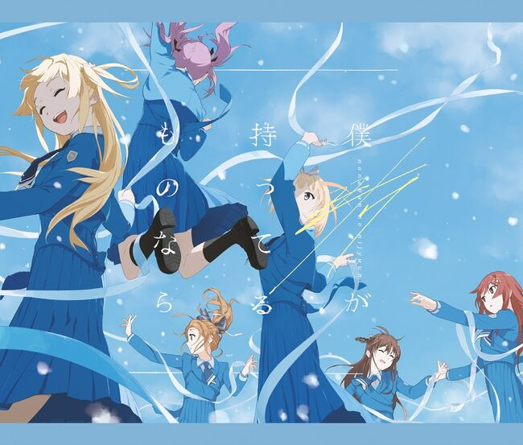
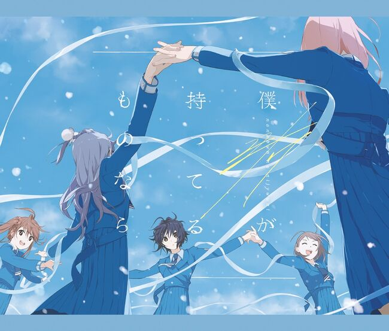
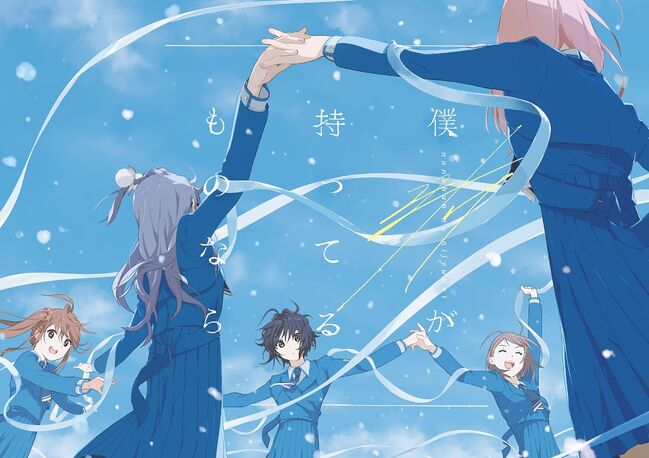

---
title: 歌曲 -  雷鸣的Delay
template: comment.html
---
# :pack-hires: 雷鸣的Delay

!!! general inline end "歌曲信息"

    === "完全生产限定盘 Type-A"
        
    === "完全生产限定盘 Type-B"
        
    === "初回规格限定盘"
        
    === "通常盘"
        
    --------
    
    <b>歌曲名称:</b> 雷鸣的Delay

    --------

    <b>日文名称:</b> 雷鳴のDelay

    ---------
    
    <b>类型:</b> 歌曲

    --------
    
    <b>发行日期:</b> 2021年2月24日

    --------

    <b>收录专辑:</b> 《若是我的所有之物》

    --------

    <b>制作人:</b> 秋元康

    --------

    <b>作词:</b> 秋元康

    --------

    <b>作曲:</b> Satoru Shirasuka

    --------

    <b>编曲:</b> Satoru Shirasuka

    --------

    <b>时长:</b> 3:49
    
    --------

    <b>发行公司:</b> Sony Music Records

## 简介

《雷鸣的Delay》是收录在22/7第7张单曲《若是我的所有之物》通常盘中的收录曲，作词由秋元康负责，作曲、编曲由Satoru Shirasuka负责，单曲于2021年2月24日正式发售，总时长3分49秒。

## 歌词

=== "日语"
    

    「何度目の雷鳴だろう　途中まで数えていたけど

    こんなに長く続く雷鳴は初めてだ」

    響き渡る雷鳴の夜　狭いこの部屋で

    僕たちは黙ったまま　ただ抱き合った

    窓の外に時折走る　青い光

    震えてる君のハート　この腕で守ろう

    土砂降りの雨風(あめかぜ)は

    若い二人　責めてるようさ

    一線を超えた恋

    大人たちは眉を顰(ひそ)める

    真夜中　落ち合って　バイクで街を出た

    初めての反抗は空も荒れてた

    怒鳴るような雷鳴の夜　灯りのない部屋

    僕たちは見えぬ未来　手探りしてた

    ただ隣に愛する人がいてくれれば

    お互いのぬくもりだけで幸せだと思う

    もしも誰かに見つかっても

    どこまでだって　また逃げればいい

    ポケットの中には　ありったけのコイン

    夢しかない暮らしはいつまでもつか？

    理想と現実　光と音　そう　いつだって時差がある

    けど

    僕たちは慌ててキスしながら

    愛を確かめる Ah

    瞼(まぶた)を閉じた雷鳴の夜　灯りのない部屋

    僕たちは見えぬ未来　手探りしてた

    ただ隣に愛する人がいてくれれば

    お互いのぬくもりだけで幸せだと思う

    愛なんて理屈じゃない　雷鳴のDelay
=== "翻译"
    

    翻译来源：绘理香Erika

    「是第几次雷声了呢」

    「我只数到了半途」

    「持续这样久的雷声还是第一次」

    雷声轰鸣响彻的夜晚 在这狭窄的房间中

    我们沉默着 紧紧相拥

    窗外偶尔有蓝色光芒 疾驰而过

    你颤抖不已的心 就让我用双手来守护吧

    倾盆的风雨

    仿佛在责备 年幼的你我

    跨过了那一线的恋情

    令大人们皱起了眉头

    深夜里 凑在一起 骑着摩托车出门

    第一次叛逆 天空也开始疯狂

    雷鸣声似怒吼般的夜里 没有点灯的房间中

    我们不断摸索着 看不见的未来

    只要身边有所爱之人陪伴

    只要有彼此的温暖 就倍感幸福

    就算被人找到

    无论去哪里都好 再次逃跑就是了

    口袋里 装着所有的硬币

    只有梦想的生活会持续到何时？

    理想与现实 光与声音

    对 无论何时都有时差

    但是

    我们在慌张的亲吻中

    确认了彼此的爱 Ah

    在这雷鸣之夜闭上双眼 没有点灯的房间中

    我们不断摸索着 看不见的未来

    只要身边有所爱之人陪伴

    只要有彼此的温暖 就倍感幸福

    爱本就毫无道理 雷鸣的延迟
    

